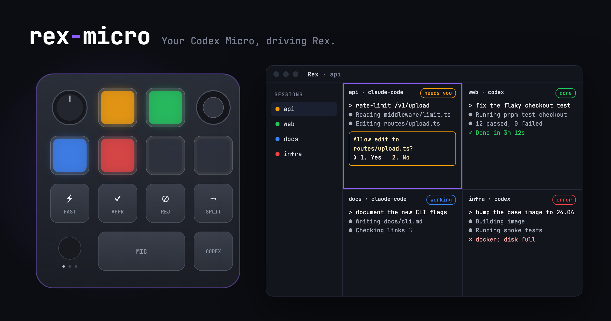
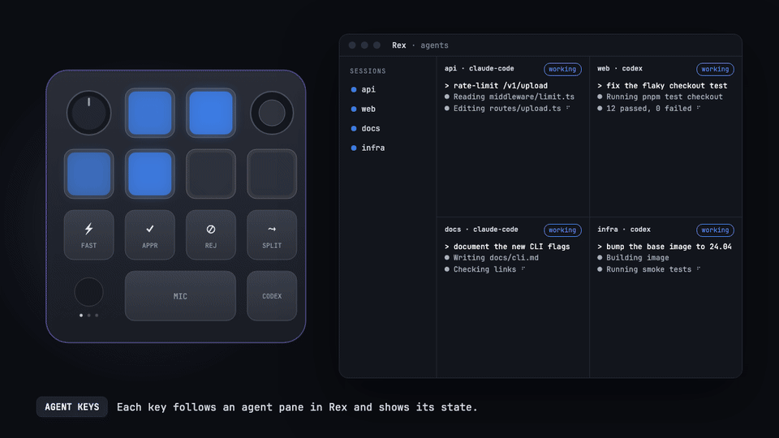

<p align="center"></p>

# rex-micro

Use a [Work Louder Codex Micro](https://worklouder.cc) as a controller for the
Rex terminal. It doesn't need the Work Louder Input app or ChatGPT.

- **Agent Keys follow your agents.** Each of the six keys tracks a pane
  running Claude Code, Codex or another agent, and shows its state in color.
  Press a key to jump to that agent's session and pane, or double-press to also zoom it.
- **Answer from the pad.** APPROVE sends Enter and REJECT sends Escape to the
  focused pane. The stick moves focus between panes, and the dial scrolls.
- **Make every key yours.** Bind any key, dial turn or stick direction to a Rex
  action, a key press, text, a `rex` command or a shell command. Add as many
  layers as you like and switch between them with the dial.

<p align="center"></p>

## Install

```sh
brew install JiehoonKwak/tap/rex-micro
rex-micro service install
rex-micro doctor
```

macOS asks once whether rex-micro may receive keystrokes. Allow it under
**System Settings → Privacy & Security → Input Monitoring**. The pad sends
its keys over a private HID channel, and macOS treats reading that channel as
input monitoring.

macOS ties that permission to the executable's path and signature. The
service runs a copy at `~/Library/Application Support/rex-micro/bin/` and
refreshes it within 30 seconds of a `brew upgrade`, so you grant the
permission only once. Releases are signed with the same self-signed
certificate every time. A build you sign yourself, or an ad-hoc build, asks
again after each change.

The Work Louder Input app and the ChatGPT desktop app also drive the pad, so
quit Input. ChatGPT has no setting to let go of the pad, but it only talks to
the pad while it has Input Monitoring: switch ChatGPT off under **Input
Monitoring** and restart it. ChatGPT keeps working; you lose only its global
dictation and modifier-only shortcuts such as Fn. `rex-micro doctor` warns
while either app runs and reports when another app has changed the lights.

rex-micro only sees keys that still have their factory keycodes on the pad's
first layer. If you remapped a key in Input, for example MIC to a dictation
shortcut, that key keeps typing its shortcut, and `rex-micro test` lists it as
handled by the device.

Requirements: macOS 13 or later, Rex with its `rex` CLI on `PATH`, and a
Codex Micro connected by USB-C or Bluetooth.

<details>
<summary>Without Homebrew</summary>

```sh
git clone https://github.com/JiehoonKwak/rex-micro && cd rex-micro
go build -o ~/.local/bin/rex-micro ./cmd/rex-micro
rex-micro service install      # starts at login via launchd
```
</details>

<details>
<summary>Verify a download</summary>

Releases are immutable and carry a build attestation. Check that a tarball
was built by the release workflow from its tag, and that it belongs to that
release:

```sh
gh attestation verify rex-micro_X.Y.Z_darwin_universal.tar.gz -R JiehoonKwak/rex-micro \
  --signer-workflow JiehoonKwak/rex-micro/.github/workflows/release.yml \
  --source-ref refs/tags/vX.Y.Z
gh release verify-asset vX.Y.Z rex-micro_X.Y.Z_darwin_universal.tar.gz -R JiehoonKwak/rex-micro
```
</details>

## Default layout

| Control | Action |
| --- | --- |
| Agent Keys | Jump to that agent's pane. Double-press to also zoom it. |
| FAST | Zoom the focused pane |
| APPROVE / REJECT | Send Enter / Escape |
| SPLIT | Split the focused pane |
| CODEX | Send Enter |
| MIC | Unbound by default; bind your dictation tool here |
| Stick | Move focus up, down, left or right |
| Dial | Turn to scroll (Page Up / Page Down); press to switch layers |

Agent Key colors:

| Color | State |
| --- | --- |
| Blue, breathing | working |
| Amber, breathing | waiting for you (permission or question) |
| Red, breathing | error |
| Green | done |
| Dim white | idle |
| Off | no agent assigned |

## Configuration

```sh
rex-micro edit           # full-screen editor: press a control on the pad to pick it
rex-micro config init    # or write ~/.config/rex-micro/config.toml yourself
rex-micro keys           # what every key does, per layer
```

`rex-micro edit` shows the pad. Press a key, turn the dial or push the stick
to select that control, then choose what each gesture does from a searchable
list of Rex actions, key presses, shortcuts, text and commands. The layer menu
(`l`) adds, renames, colors and deletes layers and sets when a layer turns on
by itself. The editor changes only the lines it must, so your comments stay.

The daemon reloads the file when you save it. The
[default config](internal/config/default.toml) documents every setting. Here
is a second layer for tools and a push-to-talk MIC key:

```toml
[[layer]]
name = "agents"
color = "#8B5CF6"

[layer.keys]
# A dictation app on a modifier hotkey: hold it as long as MIC is held, so the
# app tells a tap (toggle) from a hold (push-to-talk) itself.
MIC = { shortcut = "right_option", held = true }
# One with start/stop URLs instead:
# MIC = { down = { shell = "open -g 'myapp://dictation/start'" }, up = { shell = "open -g 'myapp://dictation/stop'" } }

[[layer]]
name = "tools"
color = "#06B6D4"

[layer.keys]
ACT06 = { rex = ["run", "--", "lazygit"] }
ACT07 = { action = "pane.split.right" }
ACT08 = { key = "ctrl+c", target = "agent" }
AG00  = { builtin = "session.1" }

[[layer]]
name = "browser"
color = "#22C55E"
match = { app = "Google Chrome" }   # on whenever Chrome is in front

[layer.keys]
ENC_CW = { shortcut = "cmd+shift+]" }   # next tab
ENC_CC = { shortcut = "cmd+shift+[" }   # previous tab
```

Each binding does exactly one thing:

| Binding | Effect |
| --- | --- |
| `{ action = "pane.zoom" }` | Run a Rex action. `rex-micro actions` lists them, including your own `rex.action` definitions from `init.lua`. |
| `{ key = "enter" }` | Send key presses to the focused pane. Add `target = "agent"` to send them to the selected agent instead. |
| `{ shortcut = "cmd+shift+]" }` | Press a keyboard shortcut in the app in front. A lone modifier (`fn`, `right_option`, `right_cmd`, ...) taps just that key, the hotkey many dictation apps use. Add `held = true` to keep it pressed while the pad key is. Needs Accessibility for rex-micro. |
| `{ text = "continue" }` | Type text into the selected agent pane |
| `{ rex = ["run", "--", "htop"] }` | Run the `rex` CLI with these arguments |
| `{ shell = "..." }` | Run a shell command |
| `{ builtin = "layer.next" }` | `layer.next`, `layer.prev`, `layer.<name>`, `session.<n>`, `agent.show`, `agent.show_zoom`, `agent.attention`, `none` |

To bind several gestures to one key, give a table for each gesture:
`press`, `double`, `hold`, `down` and `up`. Keys that a later layer leaves out
fall through to the first layer.

A layer with `match` turns on by itself. `match = { app = "Google Chrome" }`
follows the app in front, using the name macOS shows for it (`app = "Rex"`
covers Rex Beta too). `match = { program = "lazygit" }` follows the program in
the Rex pane you are looking at, and wins over an app match. When nothing
matches, the first layer is active. A layer you pick with the dial stays until
you switch apps or the program in the Rex pane changes; then the matching layer,
or the first, comes back.

Shortcut bindings need Accessibility: the daemon asks for it the first time
your config uses one, and `rex-micro doctor` checks it.

The Agent Keys have three modes. `auto` (the default) assigns agent panes in
session order and keeps each assignment stable. `sessions` gives each key one
session and shows that session's most urgent agent. `slots` follows the pane
labels or block IDs you list; prefer labels, since block IDs change when Rex
restarts.

A layer can rebind an Agent Key (`AG00 = { shortcut = "cmd+t" }`). On that
layer the key lights in the layer's color instead of its agent's state. Set
`[agents] always = true` to keep all six on their agents in every layer.

## For agents

rex-micro ships an agent skill that teaches coding agents to edit this config
safely:

```sh
rex-micro skill install            # ~/.claude/skills/rex-micro/SKILL.md
rex-micro skill install ~/.codex/skills
```

Then ask your agent something like "make the dial switch Rex tabs on a second layer".

## Commands

| Command | Purpose |
| --- | --- |
| `rex-micro edit` | Edit bindings and layers on screen |
| `rex-micro doctor` | Check Rex, the pad, permissions, the config and conflicting apps |
| `rex-micro status` | Show the pad connection, the active layer and the pane each Agent Key follows |
| `rex-micro test` | Guided hardware check: press each key and confirm the lights (`--lights` for the lights only) |
| `rex-micro monitor` | Print raw pad events |
| `rex-micro lights demo` | Play the Agent Key colors (useful for recordings) |

Logs: `~/Library/Logs/rex-micro.log`.

## How it works

The pad's keys don't send ordinary keystrokes. Every key, the dial and the
stick report over a vendor HID channel (usage page `0xFF00`) as JSON-RPC, and
the same channel drives the LEDs. rex-micro opens that channel with IOKit. It
follows Rex through one long-running `rex do` script that rebuilds a snapshot
of every pane's agent state inside the server when Rex reports a change (and
every `[rex] poll` in case one was missed), and sends key actions back through
the `rex` CLI. Protocol facts come from
[FreeMicro](https://github.com/eliBenven/freemicro)'s reverse-engineered
[PROTOCOL.md](https://github.com/eliBenven/freemicro/blob/main/docs/PROTOCOL.md).

## License

MIT. Not affiliated with Work Louder, OpenAI or Rex.
